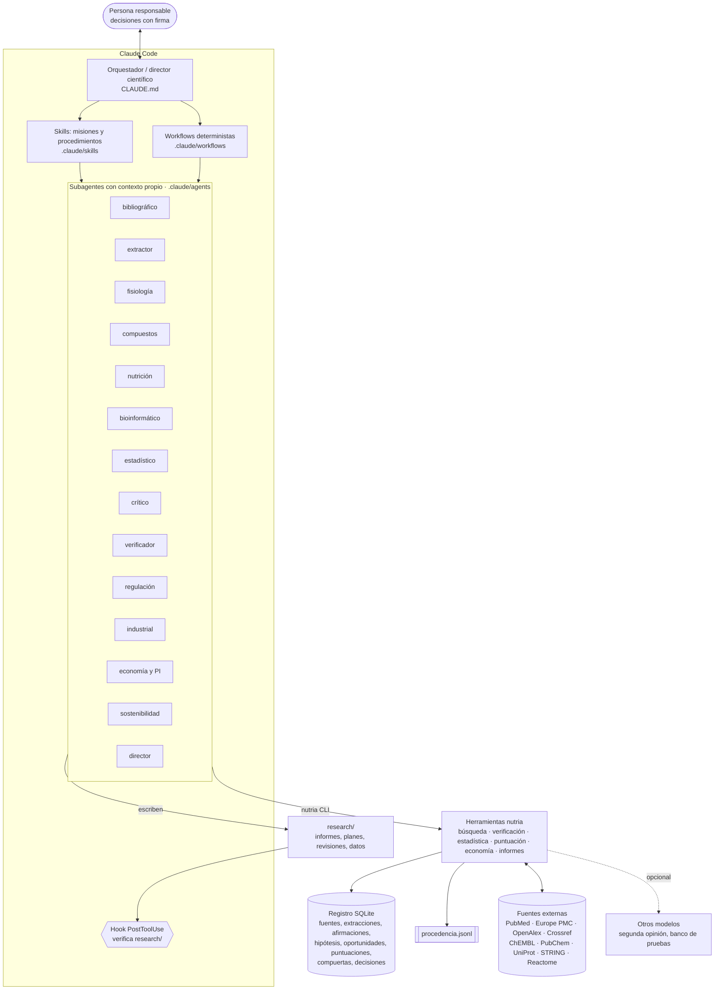
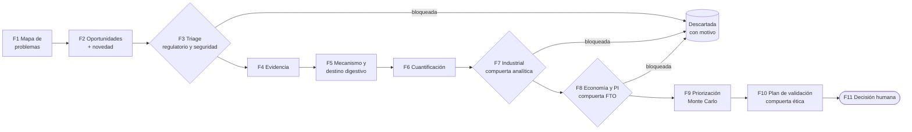
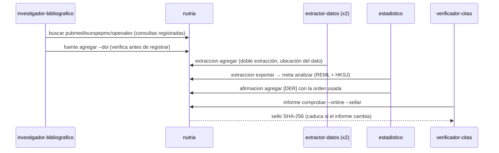

# Arquitectura del sistema

## Capas

**Principio de diseño**: el razonamiento lo hacen los agentes; todo lo que puede comprobarse de forma determinista
(existencia de una referencia, un cálculo, un ranking, una compuerta) lo hacen las herramientas, y queda registrado.

## Embudo de fases y compuertas

## Flujo de la evidencia

## Correspondencia con ficheros

| Componente | Ubicación |
|---|---|
| Constitución y reglas | `CLAUDE.md` |
| Método completo | `docs/PROMPT_MAESTRO_v2.md` |
| Roles | `.claude/agents/*.md` (14) |
| Misiones y procedimientos | `.claude/skills/*/SKILL.md` (13) |
| Orquestación determinista | `.claude/workflows/*.js` (3) |
| Permisos y hook | `.claude/settings.json`, `scripts/hooks/check_research_file.py` |
| Herramientas | `src/nutria/` (CLI `nutria`) |
| Esquemas de datos | `src/nutria/data/schemas/*.json` |
| Rúbrica y modelos | `src/nutria/data/rubrica.toml`, `src/nutria/data/modelos.toml` (personalizables en `config/`) |
| Registro y trazas | `research/nutria.sqlite`, `research/procedencia.jsonl` |
| Pruebas | `tests/` (incluye validación del metaanálisis frente a metafor) |
