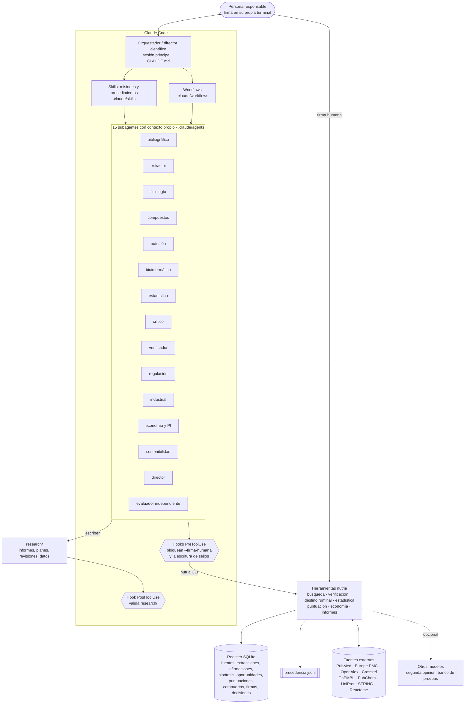

# Arquitectura del sistema

Estado real de cada pieza (qué está probado y qué no): `docs/ESTADO_Y_LIMITACIONES.md`.

## Capas



**Principio de diseño**: el razonamiento lo hacen los agentes; todo lo que puede comprobarse de forma determinista
(existencia de una referencia, un cálculo, un ranking, el estado de una compuerta) lo hacen las herramientas, y queda
registrado. Las decisiones que cuentan (compuertas superadas, selección de candidatos, verificaciones manuales, paso
de un informe a revisado) las firma una persona.

## Embudo de fases y compuertas


## Compuertas: propuesta y firma

Seis compuertas bloquean con independencia de la puntuación: `seguridad`, `regulatoria`, `analitica`,
`propiedad_intelectual`, `etica` y `destino_digestivo`.

| Paso | Quién | Efecto |
|---|---|---|
| Propuesta: `nutria --agente <rol> puntuar compuerta <ID> <compuerta> <estado> --motivo "..."` | El agente especialista (regulación propone `regulatoria`; compuestos, `seguridad`; fisiología, `destino_digestivo`; industrial, `analitica`; economía, `propiedad_intelectual`; sostenibilidad, `etica`) | `bloqueada` actúa de inmediato; `superada` queda pendiente de firma y la oportunidad sigue CONDICIONAL |
| Firma: la misma orden con `--firma-humana NOMBRE` | Solo una persona, en su propia terminal | `superada` cuenta; salir de `bloqueada` exige esta firma |
| Ruta `fuera_de_alcance_*` (medicamento, biocida) | Registro de la oportunidad | Bloquea automáticamente |

El ranking clasifica cada oportunidad como APTA (todas las compuertas superadas y firmadas), CONDICIONAL (alguna sin
resolver o sin firmar; se ordena después de las APTA), BLOQUEADA, INCOMPLETA (criterios sin puntuar) o INSUFICIENTE
(menos de 3 evaluadores distintos por criterio). Solo puntúan los subagentes `evaluador-independiente`, que leen la
oportunidad con `--sin-puntuaciones`.

## Sello de verificación de un informe

`nutria informe comprobar <informe> --online --sellar` escribe `<informe>.verificacion.json`. El sello solo es válido
si se cumplen todas estas condiciones:

1. **Verificación en línea completa**: todas las referencias verificadas (existencia y correspondencia con la cita),
   su retractación comprobada y ninguna pendiente por falta de red, error o URL sin verificación manual firmada. Una
   referencia con solo URL cuenta únicamente si una persona la registró con
   `nutria verificar manual <URL> --firma-humana NOMBRE`.
2. **Estructura completa** (las 20 secciones) y ningún error.
3. Si el estado es `revisado` o `final`: tabla de respaldo en el Anexo A, `| Ref | Afirmación | Respaldo | Motivo |`,
   con Respaldo en `respalda`, `parcial`, `no_respalda` o `no_verificable`; cada `[Rn]` usado en una línea `[PUB]`
   necesita una fila `respalda` o `parcial`. Además, `revisado_por_humano` con el nombre de la persona.
4. **El informe no ha cambiado** desde que se selló: el sello guarda la huella SHA-256 del texto exacto comprobado.
5. **Firma HMAC** con una clave que vive fuera del repositorio (`~/.config/nutria/clave_sello` o la variable
   `NUTRIA_CLAVE_SELLO`): un sello escrito a mano, alterado o copiado de otro equipo no valida.

Sin red, la verificación queda incompleta y el sello no es válido. La firma HMAC es una barrera contra sellos
falsificados o desactualizados, no una protección criptográfica frente a quien tenga acceso a la clave.

## Hooks de Claude Code (`.claude/settings.json`)

| Evento | Herramientas | Script | Qué hace |
|---|---|---|---|
| PreToolUse | Bash | `scripts/hooks/guard_bash.sh` | Bloquea cualquier orden de un agente que incluya `--firma-humana` o que toque la clave de los sellos (`clave_sello`, `NUTRIA_CLAVE_SELLO`) |
| PreToolUse | Write, Edit, MultiEdit | `scripts/hooks/guard_write.sh` | Bloquea la escritura directa de sellos (`*.verificacion.json`) y de la clave: los sellos solo los genera `nutria informe comprobar ... --online --sellar` |
| PostToolUse | Write, Edit, MultiEdit | `scripts/hooks/run_hook.sh` → `scripts/hooks/check_research_file.py` | Valida lo que se escribe en `research/`: informes (estructura, referencias, etiquetas y, si están en estado revisado o final, sello válido), planes y revisiones (referencias y etiquetas) y JSON de oportunidades e hipótesis (esquema). Si hay errores, bloquea y explica por qué |

`run_hook.sh` busca primero el intérprete del proyecto (`.venv/bin/python` o `.venv\Scripts\python.exe`) y, si no
existe, `python3` o `python`. Falla cerrado: si no encuentra Python, o el intérprete no tiene las dependencias de
`nutria`, bloquea las escrituras en `research/` que debía validar, en lugar de desactivarse en silencio.

Límites de los hooks: comparan texto en la entrada de cada herramienta, así que son una barrera frente a errores y
atajos de los agentes, no un control de seguridad frente a una persona. El hook PostToolUse solo ve lo que se escribe
con Write, Edit o MultiEdit; para cualquier otro camino, la comprobación es `nutria informe sello <informe>`.

## Flujo de la evidencia

```mermaid
sequenceDiagram
    participant B as investigador-bibliografico
    participant N as nutria
    participant E as extractor-datos (A y B)
    participant S as estadistico
    participant V as verificador-citas
    participant H as persona
    B->>N: buscar pubmed/europepmc/openalex (consultas registradas)
    B->>N: fuente agregar --doi (verifica antes de registrar)
    E->>N: extraccion agregar (dos extracciones independientes)
    E->>N: extraccion comparar A.json B.json (código 1 si hay discrepancias)
    S->>N: extraccion exportar --variable V --csv F (formato de análisis)
    S->>N: meta analizar F (REML + HKSJ por defecto)
    S->>N: afirmacion agregar [DER] con la orden usada
    V->>V: rellena la tabla de respaldo del Anexo A
    H->>N: verificar manual URL --firma-humana NOMBRE (normativa, literatura gris)
    V->>N: informe comprobar --online --sellar
    N-->>V: sello firmado (solo válido con verificación completa; caduca si el informe cambia)
```

## Correspondencia con ficheros

| Componente | Ubicación |
|---|---|
| Constitución y reglas | `CLAUDE.md` |
| Método completo | `docs/PROMPT_MAESTRO_v2.md` |
| Estado y limitaciones | `docs/ESTADO_Y_LIMITACIONES.md` |
| Roles | `.claude/agents/*.md` (15) |
| Misiones y procedimientos | `.claude/skills/*/SKILL.md` (13) |
| Workflows | `.claude/workflows/*.js` (4: `mision-1-auto`, `evaluar-oportunidad-auto` y `red-team-auto` para investigar; `comparar-sistemas` para auditar o comparar sistemas) |
| Permisos y hooks | `.claude/settings.json`; `scripts/hooks/guard_bash.sh`, `scripts/hooks/guard_write.sh`, `scripts/hooks/run_hook.sh`, `scripts/hooks/check_research_file.py` |
| Herramientas | `src/nutria/` (CLI `nutria`) |
| Sello de verificación | `src/nutria/reports/check.py`, `src/nutria/sello.py` |
| Destino ruminal | `src/nutria/destino.py` (`nutria destino ruminal`) |
| Esquemas de datos | `src/nutria/data/schemas/*.json` |
| Rúbrica y modelos | `src/nutria/data/rubrica.toml`, `src/nutria/data/modelos.toml` (personalizables en `config/`) |
| Registro y trazas | `research/nutria.sqlite`, `research/procedencia.jsonl` |
| Pruebas | `tests/` (incluye validación del metaanálisis frente a metafor y pruebas en vivo opcionales) |
