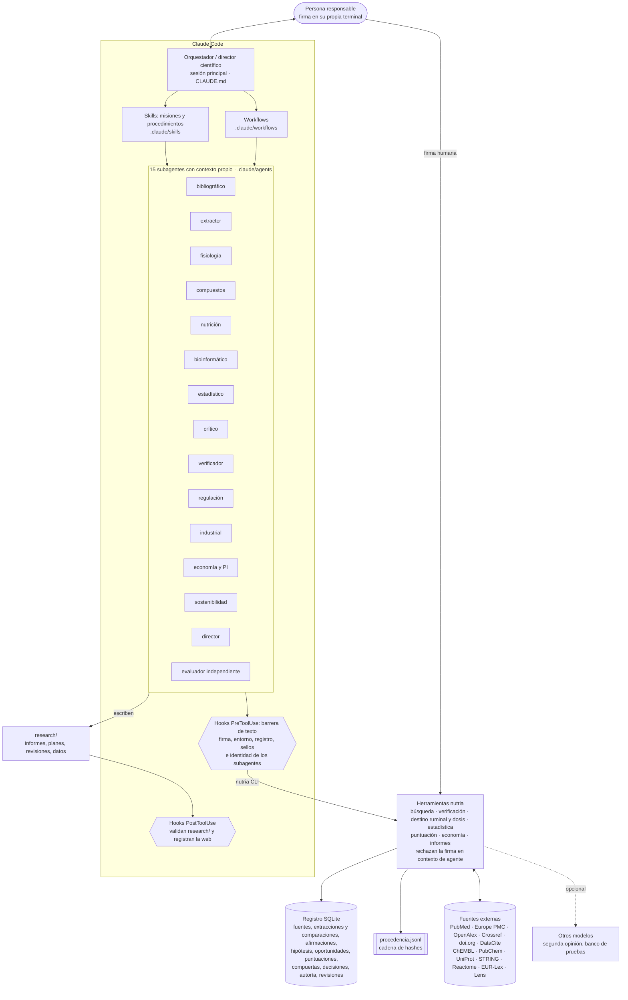
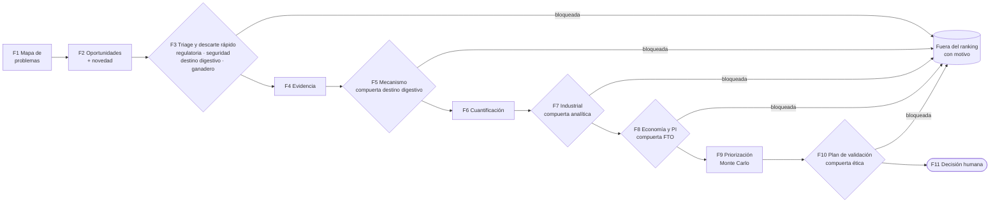

# Arquitectura del sistema

Estado real de cada pieza (qué está probado y qué no): `docs/ESTADO_Y_LIMITACIONES.md`. Con esta arquitectura
**todavía no se ha ejecutado ninguna misión ni investigación**: el registro de un proyecto nuevo está vacío, la capa
de agentes (subagentes, skills y workflows) solo se ha probado con agentes simulados y los clientes de las APIs, con
respuestas simuladas. Nada demuestra aún la calidad de los resultados que produzca.

## Capas



**Principio de diseño**: el razonamiento lo hacen los agentes (su competencia de dominio no se ha medido: ver los
bancos de `evals/` y `nutria llm evaluar`); todo lo que puede comprobarse de forma determinista (existencia de una
referencia, un cálculo, un ranking, el estado de una compuerta) lo hacen las herramientas, y queda registrado. Las
decisiones que cuentan (compuertas superadas, selección de candidatos, verificaciones manuales, paso de un informe a
revisado o final, autoría inventiva) las firma una persona.

## Embudo de fases y compuertas



## Compuertas: propuesta y firma

Seis compuertas bloquean con independencia de la puntuación: `seguridad`, `regulatoria`, `analitica`,
`propiedad_intelectual`, `etica` y `destino_digestivo`. Una rúbrica propia (`config/rubrica.toml`) puede cambiar
pesos y anclas, pero no quitarlas.

| Paso | Quién | Efecto |
|---|---|---|
| Propuesta: `nutria --agente <rol> puntuar compuerta <ID> <compuerta> <estado> --motivo "..."` | Sin firma, solo el rol propietario (`nutria.db.GATE_OWNERS`): regulacion-seguridad propone `regulatoria`; compuestos-toxicologia, `seguridad`; fisiologia-bioquimica, `destino_digestivo`; desarrollo-industrial, `analitica`; economia-mercado-pi, `propiedad_intelectual`; sostenibilidad-bienestar, `etica`. `bloqueada` la propone cualquiera | `bloqueada` actúa de inmediato; `superada` queda pendiente de firma y la oportunidad sigue CONDICIONAL; una propuesta sin firma no sustituye una decisión firmada, salvo para bloquear |
| Firma: la misma orden con `--firma-humana NOMBRE` | Solo una persona, en su propia terminal | `superada` cuenta; salir de `bloqueada` exige esta firma y `--evidencia` (IDs del registro que existan, URL o ficheros regulares del proyecto; no la propia oportunidad, el registro ni los JSON de la oportunidad) |
| Clasificación del triage: `nutria --agente regulacion-seguridad oportunidad clasificar <ID> --ruta R [--grupo-funcional G] [--situacion S] --motivo "..."` | regulacion-seguridad (o una persona con firma) | Fija la ruta, el grupo funcional (obligatorio con `aditivo_*`) y la situación; sin ella, la compuerta `regulatoria` no se propone ni se firma `superada`. Si la clasificación cambia, una compuerta `regulatoria` superada se reabre |
| Ruta `fuera_de_alcance_*` (medicamento, biocida) | Registro de la oportunidad | Bloquea automáticamente la compuerta `regulatoria`; salir de ella exige firma humana |

El ranking clasifica cada oportunidad como APTA (todas las compuertas superadas y firmadas), CONDICIONAL (alguna sin
resolver o sin firmar; se ordena después de las APTA, en tres subgrupos sea cual sea la puntuación: solo pendientes
de firma, con compuertas sin resolver y con compuertas críticas —`seguridad`, `regulatoria`, `destino_digestivo`—
sin resolver), BLOQUEADA, INCOMPLETA (criterios sin puntuar) o INSUFICIENTE (menos de 3 evaluadores distintos por
criterio; el ranking no admite exigir menos). P(top-k) se calcula sobre el ranking completo, que respeta el orden de
los grupos, y el ranking avisa cuando el orden o el top-k cambian entre perfiles de pesos o entre el Monte Carlo y el
cálculo determinista. Solo puntúan los subagentes `evaluador-independiente`, que leen la oportunidad con
`--sin-puntuaciones`; cada uno registra sus puntuaciones con `--agente evaluador-<n>` igual al campo `evaluador` del
JSON, y un valor entre anclas exige `justificacion_entre_anclas`.

## Firma humana

`--firma-humana` es una atestación sin autenticar, con tres barreras:

1. **La CLI** (`cli._firma_solo_de_personas`, justo después de analizar los argumentos): rechaza cualquier firma con
   el código 3 (texto por stderr y, con `--json`, también el objeto de error por stdout) si la orden lleva `--agente`
   o `NUTRIA_AGENT`, si el proceso está dentro de Claude Code (sus variables de entorno en el proceso o en el entorno
   inicial de un antecesor, leído en `/proc`, o Claude Code entre los antecesores; sin `/proc`, con `ps`, que no da
   el entorno inicial) o si no hay terminal de control. Ningún analizador admite abreviaturas (`_Parser`,
   `allow_abbrev=False`).
2. **El registro** (`db.require_human_signature`): las mismas comprobaciones, también para quien llame a la API de
   `nutria.db` (compuertas, decisiones, cambios de estado de oportunidades e hipótesis, verificaciones manuales,
   clasificación, revisión de informes y autoría).
3. **El hook de Bash** (`guard_bash.sh`): una barrera de texto adicional (ver la tabla de hooks).

Residuos: un proceso del mismo usuario desvinculado de Claude Code, con el entorno vacío y una terminal propia que el
hook no reconozca; en Windows, vaciar el entorno; una copia modificada de nutria; quien escriba en la base de datos;
una persona malintencionada. En la sesión principal, `--agente` es declarado.

## Registro (`research/nutria.sqlite`)

Lo crea `nutria init` y solo lo escribe la CLI (`src/nutria/db.py`). Además de las tablas de fuentes, afirmaciones
(con su `context` biológico), hipótesis, oportunidades, puntuaciones, compuertas, verificaciones manuales y
decisiones:

- `scores_history`, `decisions` e `inventive_contributions` (autoría inventiva, registrada por una persona) son solo
  de inserción: disparadores de SQLite contra UPDATE, DELETE e INSERT OR REPLACE, que se crean también en los
  registros existentes al conectar. `decisions.context` guarda si la decisión se registró desde Claude Code o desde
  una terminal, y una decisión solo se registra sobre una entidad que existe.
- `normalize_rater` normaliza el identificador del evaluador (NFKC, guiones tipográficos, caracteres de formato
  invisibles, espacios y mayúsculas) y el ranking cuenta cada evaluador una vez, también en puntuaciones antiguas.
- Doble extracción: `extraction_copies` (copias A y B depositadas, con su SHA-256, definitivas) y
  `extraction_comparisons` (comparaciones registradas y su conciliación, una por comparación), con disparadores que
  impiden modificarlas. El estado de doble extracción solo lo fija el registro: `verified_extraction_ids` da por
  verificada una fila solo si coincide con su comparación o con su conciliación (también la conciliación hacia un
  dato no publicado). Las identidades se comparan con `actor_key` (sin mayúsculas, tildes ni signos); quien
  participó en una comparación con discrepancias no vuelve a extraer esa fuente, y los alias de una fuente tras una
  fusión DOI/PMID cuentan como la misma fuente. Las extracciones llevan PDR, hito y ventanas respecto al parto,
  definición de caso, suplementación, `correlacion_intrasujeto` (columna `within_r`) y la comparación de la que
  salieron.
- Oportunidades: `functional_group`, `regulatory_situation`, `classified_by` y `classified_at` (la clasificación del
  triage, `oportunidad clasificar`).
- `report_reviews`: revisiones humanas de informes, ligadas a la huella de su contenido.
- Los esquemas (`src/nutria/data/schemas/*.json`) llevan la palabra clave `x-texto` (vocabulario de valores genéricos
  y de relleno, grupos de especies), que aplica `db.schema_errors` y que un validador JSON Schema genérico ignora; las
  incidencias publicadas como proporción se reconocen por vocabulario y exigen eventos, ventana y definición de caso.

## Procedencia (`research/procedencia.jsonl`)

Cada evento lleva `ts`, `actor` (--agente, `NUTRIA_AGENT` o "cli"), `action`, `inputs`, `outputs` (sin secretos),
`nutria` (versión), `contexto` ("claude-code" o "terminal"), `sesion_claude_code` (enlaza con la transcripción, donde
constan el agente y el modelo, que la CLI no conoce), `git` (commit y cambios sin confirmar fuera de `research/`),
`entorno` (versiones de Python y de las bibliotecas de cálculo), opcionalmente `parametros` y `huellas` de entrada y
salida, y `prev` y `hash`, la cadena. Se escribe con `provenance.log_event`, la API que usan todas las órdenes; git
solo se llama desde `_run_git`. `nutria procedencia verificar` (`verify_chain`) detecta líneas corruptas, eventos
alterados, la cadena rota, eventos sin cadena añadidos después y, si el fichero está en git, la reescritura o el
borrado de eventos confirmados (lo compara, por identificador de objeto, con las versiones del historial de HEAD y
de las puntas anteriores de la rama en su reflog). Límites: una cadena de hashes no autentica (quien escriba el
fichero puede recalcular la cola o truncar lo no confirmado), la referencia es el repositorio local (reescribir la
historia y borrar después el reflog de la rama la elude, y el hook de Bash solo reconoce algunas formas de borrarlo:
ver la tabla de hooks) y dos ramas que añadan eventos la rompen al fusionarse.

Eventos de la red y la caché: `http` (clave de la caché, SHA-256 y cabeceras), `http_cache` (fecha y antigüedad de
la copia servida), `http_cache_descartada`, `http_error` (motivo), `http_sonda`, `doctor` (con
`versiones_no_reconocidas`), `busqueda`, `molecula`, `diana`, `proteina`, `red_string` y `rutas` (con la sensibilidad
y las huellas), `cache_exportar`, `cache_importar` y `normativa`. Los hooks web añaden `web_fetch` y `web_search`.

## Red, caché y errores

`src/nutria/http.py` concentra las peticiones: caché con integridad confirmada por la procedencia (una copia alterada
o plantada se descarta con aviso), validación de cada respuesta (`validate=`, también de las versiones de las bases,
con `sources/base.py:checked_version`), intervalos y turnos de concurrencia entre procesos que comparten la caché
(límites de Crossref; con `fcntl`, en POSIX: en Windows solo dentro de cada proceso), `NetworkError` con su motivo (red, bloqueado, conexion, servicio, peticion, credenciales,
limite, respuesta, offline, no_encontrado) y la sonda de `doctor`. `sources/eurlex.py` da los metadatos de normativa,
`sources/doiorg.py` consulta doi.org y DataCite, y `verify/citations.py` verifica las referencias. La tabla de
códigos de salida está en `cli.CODIGOS_SALIDA` (también en `nutria --help`); `cli._error` escribe siempre el error
por stderr y, con `--json`, además un objeto JSON por stdout, y `_imprimir`, `_vaciar_stdout` y `_silenciar` tratan
las tuberías y los flujos cerrados sin traza.

## Sello de verificación de un informe

`nutria informe comprobar <informe> --online --sellar` escribe `<informe>.verificacion.json`. El sello solo es válido
si se cumplen todas estas condiciones:

1. **Verificación en línea completa**: todas las referencias verificadas (existencia y correspondencia con la cita),
   su retractación comprobada y ninguna pendiente por falta de red, error o URL sin verificación manual firmada (un
   DOI registrado en doi.org sin metadatos comparables queda pendiente: `existe_sin_metadatos`). Una referencia con
   solo URL cuenta únicamente si una persona registró cada URL de la entrada con
   `nutria verificar manual <URL> --firma-humana NOMBRE`. Con 0 referencias, el sello dice «no había referencias que
   verificar».
2. **Estructura completa** (las 20 secciones), exigida en los documentos de `research/informes` (también en
   subcarpetas); fuera de ellos el sello puede no comprobarla (`--sin-secciones`), y lo dice. Ningún `[POR
   COMPLETAR]` ni sección vacía (el esqueleto de `informe nuevo` nunca tiene sello válido) y ningún error: cifras con
   unidades y medidas de efecto con su etiqueta, por frase y en las tablas por su estructura; citas solo como `[Rn]`
   (las numéricas y las autor-año sin `[Rn]` en su frase son error, y en revisado o final también la autor-año cuyos
   apellidos y año no figuran en la entrada de ninguna `[Rn]` de su frase; la comparación es léxica); ningún
   identificador de artículo en el cuerpo fuera de la bibliografía
   (el sello cuenta los enlaces del cuerpo sin verificar); y una `[PUB]` que no se limite a remitir a la frase
   anterior.
3. Si el estado es `revisado` o `final`: tabla de respaldo en el Anexo A, `| Ref | Afirmación | Respaldo | Motivo |`,
   con Respaldo en `respalda`, `parcial`, `no_respalda` o `no_verificable`, con una fila por cada afirmación con
   `[Rn]` (de cualquier etiqueta) y por cada referencia, que reproduzca su texto, con `respalda` o `parcial` (las
   filas, solo en el Anexo A; en `research/revisiones`, las tablas de veredictos no cuentan); la revisión humana
   registrada con `nutria informe revisar` (`report_reviews`, ligada a la huella del contenido); la revisión del
   crítico enlazada en `revision_critica`; las fuentes registradas y verificadas; y la sección 14 coherente con el
   registro (ruta declarada y estado efectivo de las compuertas, sin el texto tachado u oculto).
4. **El informe no ha cambiado** desde que se selló: el sello guarda la huella SHA-256 del texto exacto comprobado.
5. **Firma HMAC** con una clave que vive fuera del repositorio (`~/.config/nutria/clave_sello` o la variable de
   entorno de la clave): un sello escrito a mano, alterado o copiado de otro equipo no valida.

`nutria verificar <informe.md> --sellar` aplica a los informes los mismos criterios. Sin red, la verificación de un
informe que cite algún DOI o PMID queda incompleta y el sello no es válido. La firma HMAC es una barrera contra sellos
falsificados o desactualizados, no una protección criptográfica frente a quien tenga acceso a la clave (cualquier
proceso del mismo usuario; el hook de Bash solo bloquea las órdenes que nombran la clave o su directorio, no las que
recorren todo el directorio personal, y con Bash se puede escribir un fichero de sello). La clave es de cada
máquina: en otra máquina o en otro clon, ningún sello existente valida hasta volver a sellar con red.

## Hooks de Claude Code (`.claude/settings.json`)

| Evento | Herramientas | Script | Qué hace |
|---|---|---|---|
| PreToolUse | Bash | `scripts/hooks/guard_bash.sh` | Barrera de texto con listas no exhaustivas. Bloquea la firma (`--firma-humana` y sus prefijos desde `--fir`, también construida por partes); tocar las variables de Claude Code o `NUTRIA_AGENT`, vaciar el entorno, cambiar de usuario, desvincular procesos o darles una terminal propia; escribir, borrar o restaurar el registro y la procedencia por fuera de la CLI (también con comodines y con borrados literales como `unlink` o `find -delete`), borrar `research/`, git que descarta cambios sin confirmar; algunas formas de borrar el reflog (`git reflog expire\|delete`, `update-ref`, `gc.reflogExpire` y borrar, mover o reescribir `.git`, `.git/logs` o `.git/refs` con la ruta escrita en la orden, también sola tras la orden, con `//` o `/./` o con comodines o llaves que la cubran; no `cd .git && rm -rf logs`, `find .git/logs -delete` ni una ruta construida con variables, y en la sesión principal tampoco `git branch -D` ni la historia reescrita con `commit --amend`, `reset --soft` o `rebase`); las órdenes que nombran la clave de los sellos o su directorio (`clave_sello`, su variable de entorno, `~/.config/nutria`; no las que recorren todo el directorio personal) y el módulo de sellos. Dentro de un subagente: cada orden nutria con `--agente` literal y ejecutada directamente, sin el nombre exacto de otro rol ni `evaluador-<n>` (otros nombres pasan; `evaluador-independiente` se identifica siempre como evaluador y no importa nutria ni nombra `nutria.sqlite` en la orden, pero puede leer `research/` con `grep -r`, `cat` o Read), sin `NUTRIA_AGENT` ni `set -a`, git solo para leer, añadir y confirmar |
| PreToolUse | Write, Edit, MultiEdit | `scripts/hooks/guard_write.sh` | Bloquea la escritura directa de sellos (`*.verificacion.json`), de la clave y `~/.config/nutria`, de `procedencia.jsonl`, de los ficheros `*.sqlite` del registro y de `.git/`, sin distinguir mayúsculas: los sellos solo los genera `nutria informe comprobar ... --online --sellar` |
| PostToolUse | Write, Edit, MultiEdit | `scripts/hooks/run_hook.sh` → `scripts/hooks/check_research_file.py` | Valida lo que se escribe en `research/`: informes (también en subcarpetas y con la extensión en mayúsculas; estado leído del front matter, que si es ilegible cuenta como error; estructura, referencias, etiquetas, cifras y citas y, si están en revisado o final, revisión humana registrada y sello válido), planes y revisiones (referencias y etiquetas; en borrador, los identificadores y «según R1» solo avisan) y JSON de oportunidades e hipótesis (esquema con las reglas del registro, `db.schema_errors`). Actúa después de escribir: si hay errores, devuelve a Claude Code la decisión «block» con el motivo, pero el fichero queda escrito (lo que garantiza un informe es su sello) |
| PostToolUse | WebFetch, WebSearch | `scripts/hooks/registrar_web.sh` → `scripts/hooks/registrar_web.py` | Registra cada consulta web en `research/procedencia.jsonl` (fecha, sesión, id de llamada, modo y SHA-256 de la respuesta, nunca su contenido). Por defecto (modo hash) solo el dominio y la huella de la URL o de la consulta; con `NUTRIA_PROCEDENCIA_WEB=claro`, la URL y la consulta en claro, redactadas (credenciales, parámetros sensibles, fragmento y correos); nunca bloquea |

`run_hook.sh` busca primero el intérprete del proyecto (`.venv/bin/python` o `.venv\Scripts\python.exe`) y, si no
existe o falla, `python3` o `python`. Falla cerrado: si no encuentra Python, si ningún intérprete tiene las
dependencias de `nutria` o si el intérprete sale con error, devuelve la decisión «block» por cada escritura en
`research/` que debía validar, en lugar de desactivarse en silencio (el fichero ya está escrito: un PostToolUse no
deshace la escritura).

Límites de los hooks: comparan texto en la entrada de cada herramienta, así que son una barrera frente a errores y
atajos de los agentes, no un control de seguridad frente a una persona; los eluden un programa escrito antes en un
fichero y los nombres construidos de forma indirecta, y en la sesión principal no comprueban el rol declarado. No se
protegen a sí mismos: `guard_write.sh` deja editar `scripts/hooks/`, `.claude/settings.json` y `src/nutria/` (la CLI,
instalada en modo editable), y con Bash también se editan. Read, Grep y Glob no tienen hook: la ceguera de los
evaluadores frente a los ficheros de `research/` (registro, procedencia, puntuaciones de otros) depende de su
instrucción. El hook PostToolUse solo ve lo que se escribe con Write, Edit o MultiEdit, y no lo deshace; para
cualquier otro camino, la comprobación es `nutria informe sello <informe>`.

## Flujo de la evidencia

```mermaid
sequenceDiagram
    participant B as investigador-bibliografico
    participant N as nutria
    participant E as extractor-datos (A y B)
    participant C as comparador / conciliador
    participant S as estadistico
    participant V as verificador-citas
    participant H as persona
    B->>N: buscar pubmed/europepmc/openalex (consultas registradas; confidenciales, solo su huella)
    B->>N: fuente agregar --doi (verifica antes de registrar)
    E->>N: extraccion depositar --datos A.json y B.json (cada extractor la suya; copia definitiva)
    C->>N: extraccion comparar A.json B.json --registrar (código 1 si hay discrepancias: CE-xxxx)
    C->>N: extraccion conciliar CE-xxxx --datos conciliacion.json (distinto de A y B)
    S->>N: extraccion exportar --variable V --csv F (con --especie E; solo filas verificadas y con tamaño del efecto)
    S->>N: meta analizar F (REML + HKSJ modificado por defecto; se niega con las filas que F marca sin doble extracción)
    S->>N: afirmacion agregar [DER] con la orden usada
    V->>N: afirmacion comprobar (cita textual frente al resumen)
    V->>V: rellena la tabla de respaldo del Anexo A
    H->>N: verificar manual URL --firma-humana NOMBRE (normativa, literatura gris)
    V->>N: informe comprobar --online --sellar
    N-->>V: sello firmado (solo válido con verificación completa; caduca si el informe cambia)
    H->>N: informe revisar --firma-humana NOMBRE --estado revisado|final, y se vuelve a sellar
```

### Evaluación en profundidad (`evaluar-oportunidad-auto`)

Compuertas efectivas leídas del registro → descarte rápido en paralelo (regulación, toxicología, destino digestivo y
modelo del ganadero; se detiene si alguna compuerta queda bloqueada) → plan y revisión bibliográfica → doble
extracción por estudio (identidades por ejecución, depositar, comparar con registro y conciliar) y metaanálisis si hay
al menos 3 estudios comparables → especialistas con crítica y verificación → compuertas y procedencia leídas antes de
puntuar → puntuación ciega de 3 evaluadores, antes de la síntesis → informe → sello comprobado con la salida literal
de nutria a la vez que la procedencia tras puntuar (detecta registros prematuros) → registro de las puntuaciones solo
con sello válido y `sha256sum -c` de cada fichero emitido. Si el sello no es válido, las puntuaciones quedan
pendientes con su sha256 y se registran después con `{"id": ..., "registrar_puntuaciones": [...]}`.

Límite de todos los workflows: no ejecutan órdenes. El sello, el `sha256sum -c`, la procedencia, las compuertas y la
selección se comprueban sobre la salida que un agente copia de `nutria`, `sha256sum` o `nutria procedencia`; una
salida falsificada a propósito no se detecta, y la detección de registros prematuros se escapa si entre las dos
lecturas de la procedencia se añaden más de 20 eventos de puntuación.

## Correspondencia con ficheros

| Componente | Ubicación |
|---|---|
| Constitución y reglas | `CLAUDE.md` |
| Método completo | `docs/PROMPT_MAESTRO_v2.md` |
| Estado y limitaciones | `docs/ESTADO_Y_LIMITACIONES.md` |
| Roles | `.claude/agents/*.md` (15) |
| Misiones y procedimientos | `.claude/skills/*/SKILL.md` (13) |
| Workflows | `.claude/workflows/*.js` (4: `mision-1-auto`, `evaluar-oportunidad-auto` y `red-team-auto` para investigar; `comparar-sistemas` para auditar o comparar sistemas), probados con `tests/orquestacion_harness.cjs` (agentes simulados) |
| Permisos y hooks | `.claude/settings.json`; `scripts/hooks/guard_bash.sh`, `scripts/hooks/guard_write.sh`, `scripts/hooks/run_hook.sh`, `scripts/hooks/check_research_file.py`, `scripts/hooks/registrar_web.sh`, `scripts/hooks/registrar_web.py` |
| Herramientas | `src/nutria/` (CLI `nutria`; códigos de salida en `cli.CODIGOS_SALIDA`) |
| Registro y procedencia | `src/nutria/db.py`, `src/nutria/provenance.py` |
| Red, caché y fuentes | `src/nutria/http.py`, `src/nutria/sources/*.py` (con `base.py:checked_version`, `doiorg.py` y `eurlex.py`), `src/nutria/verify/citations.py` |
| Sello de verificación | `src/nutria/reports/check.py`, `src/nutria/sello.py` |
| Destino ruminal | `src/nutria/destino.py` (`nutria destino ruminal`) |
| Conversión de dosis | `src/nutria/dosis.py` (`nutria dosis convertir`) |
| Economía | `src/nutria/econ/farm.py`, `src/nutria/econ/rnpv.py`, `src/nutria/econ/dist.py` (`nutria econ ganadero`, `desarrollador` y `coherencia`) |
| Estadística | `src/nutria/stats/*.py` (`nutria meta` y `nutria potencia`) |
| Esquemas de datos | `src/nutria/data/schemas/*.json` |
| Rúbrica y modelos | `src/nutria/data/rubrica.toml`, `src/nutria/data/modelos.toml` (personalizables en `config/`; una rúbrica propia no puede quitar las seis compuertas) |
| Bancos de evaluación de modelos | `evals/dominio_semilla.jsonl`, `evals/clasificacion_regulatoria.jsonl` (`nutria llm evaluar`; resultados en `research/evals/`) |
| Registro y trazas | `research/nutria.sqlite`, `research/procedencia.jsonl` (los crea `nutria init`) |
| Demostración sin red | `scripts/demo_sin_red.py` |
| Pruebas | `tests/` (incluye validación del metaanálisis frente a metafor, la demostración sin red y pruebas en vivo opcionales) |
