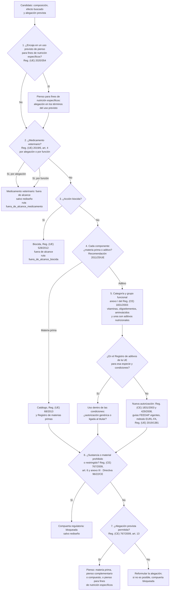

# Mapa regulatorio de la UE para productos de alimentación animal

Referencia de trabajo para el agente `regulacion-seguridad` y la skill `triage-regulatorio`. **No es asesoramiento
jurídico**: las conclusiones son preliminares y las revisa un profesional de asuntos regulatorios.

**Estado de verificación.** "verificada (2026-11-04)" significa que lo que este documento dice de esa norma se
comprobó por búsqueda web en esa fecha, y solo eso (si una fila verifica solo un artículo, lo indica). "pendiente"
significa que no se ha comprobado: es una cita de referencia que hay que contrastar antes de usarla en una decisión.
Solo las filas de los Reglamentos (CE) 1831/2003 (CELEX 32003R1831) y 1829/2003 (CELEX 32003R1829) indican su número
CELEX, y ninguna registra todavía la fecha de la versión consolidada consultada; los enlaces ELI que terminan en `/oj`
llevan al acto original publicado en el Diario Oficial, no a la versión consolidada. Antes de una decisión, consulta
el texto consolidado vigente en EUR-Lex y anota su fecha.

En un informe, una norma citada solo con URL cuenta como verificada únicamente si una persona la registró con
`nutria verificar manual <URL> --firma-humana NOMBRE`; los agentes no pueden hacerlo.

## Clasificación: árbol de decisión

Las preguntas van en este orden, el mismo de la skill `triage-regulatorio`.

1. **Pienso para fines de nutrición específicos** (Reglamento (UE) 2020/354; verificada (2026-11-04)). Se pregunta
   primero para que los usos previstos de la lista, como la reducción del riesgo de cetosis o de fiebre de la leche,
   no acaben clasificados como medicamento por la forma de la alegación. La entrada de fiebre de la leche la modificó
   el Reglamento (UE) 2024/2899. El reglamento expresa la DCAD como (Na + K) − (Cl + S), en mEq/kg de MS. Si el
   objetivo encaja, la alegación se formula en los términos de ese uso previsto. Las características nutricionales y
   las condiciones de etiquetado de cada uso están en la lista del reglamento (pendiente: consultar la entrada
   concreta). El árbol sigue al paso 2 en cualquier caso.
2. **Medicamento veterinario** (Reglamento (UE) 2019/6, art. 4; verificada (2026-11-04)). La definición tiene dos
   criterios y basta uno:
   - **por alegación o presentación**: se presenta como tratamiento o prevención de enfermedades;
   - **por función**: se usa en animales o se les administra para restablecer, corregir o modificar funciones
     fisiológicas ejerciendo una acción farmacológica, inmunológica o metabólica.

   Con el criterio funcional, cambiar solo la alegación no basta: el rediseño tiene que afectar a la sustancia, la
   dosis o el mecanismo. La ruta `fuera_de_alcance_medicamento` bloquea automáticamente la compuerta `regulatoria`.
   Si la frontera es dudosa, la propuesta es `no_resuelta` con revisión profesional, nunca `superada`.
3. **Biocida** (Reglamento (UE) 528/2012; pendiente): acción sobre el entorno, p. ej. desinfección. Fuera de alcance;
   la ruta `fuera_de_alcance_biocida` también bloquea automáticamente.
4. **Materia prima o aditivo**, componente a componente (Recomendación 2011/25/UE, directrices para distinguir
   materia prima, aditivo, biocida y medicamento veterinario; verificada (2026-11-04)). "Cubrir necesidades
   nutricionales" no basta para clasificar algo como materia prima: la categoría de aditivos nutricionales del anexo
   I del Reglamento (CE) 1831/2003 incluye vitaminas, compuestos de oligoelementos, aminoácidos y urea (verificada
   (2026-11-04)). La dosis baja, por sí sola, tampoco decide.
5. **Aditivo: categoría, grupo y autorización**. Comprueba en el Registro de aditivos de la UE la especie, las
   condiciones y si la autorización es genérica o ligada a un titular. Si es nuevo, sigue la vía de autorización de
   más abajo.
6. **Sustancias prohibidas o restringidas**: lista de comprobación de más abajo. Un "sí" bloquea la compuerta
   `regulatoria` salvo rediseño.
7. **Alegaciones** (Reglamento (CE) 767/2009, art. 13; verificada (2026-11-04)): sección de más abajo. En la fase
   computacional la alegación es una propuesta para el triage, no una alegación comercial.

La compuerta la **propone** el agente, sin `--firma-humana`:
`nutria --agente regulacion-seguridad puntuar compuerta <ID> regulatoria <estado> --motivo "..."`. Una propuesta
`bloqueada` actúa de inmediato; `superada` solo cuenta cuando la firma una persona, y salir de `bloqueada` también
exige firma humana.

## Categorías y grupos funcionales de aditivos (anexo I del Reglamento (CE) 1831/2003)

| Categoría | Grupos funcionales (resumen) | Verificación |
|---|---|---|
| Tecnológicos | Conservantes, antioxidantes, emulgentes, estabilizantes, espesantes, gelificantes, aglutinantes, control de radionúclidos, antiaglomerantes, reguladores de acidez, aditivos de ensilado, desnaturalizantes, reducción de micotoxinas, potenciadores de las condiciones higiénicas y **otros aditivos tecnológicos** (añadido por el Reglamento (UE) 2019/962) | verificada (2026-11-04) solo el grupo "otros aditivos tecnológicos"; resto pendiente |
| Sensoriales | Colorantes, aromatizantes | pendiente |
| Nutricionales | Vitaminas, compuestos de oligoelementos, aminoácidos y urea | verificada (2026-11-04) que la categoría los incluye; nombres exactos de los grupos pendientes |
| Zootécnicos | Digestibilidad, estabilizadores de la flora intestinal, sustancias que influyen favorablemente en el medio ambiente, otros zootécnicos y **estabilizadores de las condiciones fisiológicas** (Reglamento (UE) 2019/962: animales sanos, resiliencia frente a factores de estrés) | verificada (2026-11-04) solo el grupo de estabilizadores de las condiciones fisiológicas; resto pendiente |
| Coccidiostáticos e histomonóstatos | — | pendiente |

Un estabilizador de las condiciones fisiológicas es para animales sanos: si el producto actúa restableciendo,
corrigiendo o modificando funciones fisiológicas con una acción farmacológica, inmunológica o metabólica, la
pregunta 2 del árbol va antes que la elección del grupo funcional.

## Sustancias prohibidas o restringidas (lista de comprobación)

- [ ] **Materiales restringidos o prohibidos** (Reglamento (CE) 767/2009, art. 6 y anexo III; verificada
  (2026-11-04)): los piensos no pueden contener materiales cuya comercialización o uso en alimentación animal esté
  restringido o prohibido; el anexo III los enumera (p. ej. semillas tratadas con fitosanitarios tras la cosecha,
  madera tratada con protectores).
- [ ] **Sustancias de efecto hormonal o tireostático y beta-agonistas** (Directiva 96/22/CE, modificada por las
  Directivas 2003/74/CE y 2008/97/CE; verificada (2026-11-04)): prohibidas en ganadería, con excepciones
  terapéuticas o zootécnicas controladas.
- [ ] **Restricciones de EET** a las proteínas de origen animal (Reglamento (CE) 999/2001): pendiente de verificar
  el anexo vigente.
- [ ] **Antibióticos distintos de coccidiostáticos e histomonóstatos como aditivos**: no pueden autorizarse como
  aditivos para piensos (Reglamento (CE) 1831/2003, art. 11, apartado 2; CELEX 32003R1831; pendiente de verificación
  en el texto consolidado). La prohibición no se limita a los promotores del crecimiento: vale sea cual sea la
  finalidad, así que alcanza también a los **moduladores ruminales antimicrobianos para vacuno (p. ej. ionóforos
  como la monensina)** y a los reductores de metano que sean antibióticos. La única excepción es su autorización como
  coccidiostático o histomonóstato (categoría propia de aditivos, para las especies y condiciones de esa
  autorización), que no ampara el uso como modulador ruminal (pendiente de verificación). Para esa finalidad no hay
  vía como pienso ni como aditivo: la compuerta `regulatoria` se propone `bloqueada` salvo rediseño del activo (no basta cambiar la
  alegación), y la vía del medicamento veterinario queda fuera de alcance. Con otros antimicrobianos (p. ej.
  extractos vegetales o compuestos de síntesis) propuestos con esa finalidad, hay que comprobar si encajan en la
  definición de antibiótico del reglamento (antimicrobiano producido por un microorganismo o derivado de él; art. 2,
  pendiente de verificación) y si son medicamento por función (Reglamento (UE) 2019/6, art. 4); mientras no esté
  claro, la propuesta es `no_resuelta`, nunca `superada`. La auditoría externa señala además el art. 107.2 del
  Reglamento (UE) 2019/6 (uso de antimicrobianos en medicamentos veterinarios): pendiente de verificación.
- [ ] **Sustancias indeseables** (Directiva 2002/32/CE): contenidos máximos; pendiente.

## Alegaciones (Reglamento (CE) 767/2009, art. 13; verificada (2026-11-04))

- **Art. 13.1**: las alegaciones deben ser objetivas, verificables por las autoridades y comprensibles, y el
  responsable debe aportar justificación científica si se le pide (pruebas científicas públicas o investigación
  documentada de la empresa).
- **Art. 13.2**: se permiten las alegaciones sobre la optimización de la nutrición y sobre el apoyo o la protección
  de las condiciones fisiológicas, salvo que sean alegaciones de prevenir, tratar o curar enfermedades.
- **Art. 13.3.a**: prohíbe las alegaciones de prevenir, tratar o curar enfermedades, con excepciones limitadas. El
  texto exacto de las excepciones está pendiente de verificar (la auditoría externa menciona los coccidiostáticos e
  histomonóstatos y los desequilibrios nutricionales).
- Un extracto autorizado como aromatizante (aditivo sensorial) no puede comercializarse alegando efectos
  zootécnicos (base legal pendiente de verificar).
- Una alegación permitida por el art. 13.2 no saca al producto de la definición de medicamento por función
  (pregunta 2 del árbol).

## Vía de autorización de un aditivo nuevo

- Solicitud según los Reglamentos (CE) 1831/2003 y 429/2008 (pendiente) y las guías vigentes del Panel FEEDAP de
  EFSA (sección siguiente).
- Método analítico evaluado por el laboratorio de referencia de la UE (EURL-FA). La auditoría externa señala el
  Reglamento (CE) 378/2005 como base de sus funciones: pendiente de verificar.
- **Reglamento (UE) 2019/1381** (transparencia; aplicable desde el 27-03-2021; verificada (2026-11-04)): añade al
  Reglamento (CE) 178/2002 el asesoramiento previo de EFSA antes de presentar una solicitud (art. 32a) y la
  obligación de notificar a EFSA los estudios encargados para respaldar una solicitud (art. 32b). Planifica la
  notificación **antes** de encargar estudios para un dossier.
- Plazo y coste: estímalos con fuentes o como `[SUP]` en `nutria econ desarrollador`.

## Normativa de referencia

| Norma | Ámbito | Cuándo aplica | Verificación |
|---|---|---|---|
| [Reglamento (CE) 178/2002](https://eur-lex.europa.eu/eli/reg/2002/178/oj) | Legislación alimentaria general (incluye piensos), EFSA; arts. 32a y 32b añadidos por el Reglamento (UE) 2019/1381 | Siempre; antes de preparar una solicitud | verificada (2026-11-04) solo los arts. 32a y 32b; resto pendiente |
| [Reglamento (UE) 2019/1381](https://eur-lex.europa.eu/eli/reg/2019/1381/oj) | Transparencia: asesoramiento previo de EFSA (art. 32a del Reglamento (CE) 178/2002) y notificación a EFSA de los estudios encargados para respaldar una solicitud (art. 32b); aplicable desde el 27-03-2021 | Antes de encargar estudios para un dossier | verificada (2026-11-04) |
| [Reglamento (CE) 1831/2003](https://eur-lex.europa.eu/eli/reg/2003/1831/oj) (CELEX 32003R1831) | Aditivos: autorización, categorías, etiquetado, protección de datos; art. 11, apartado 2: los antibióticos distintos de coccidiostáticos e histomonóstatos no pueden autorizarse como aditivos, sea cual sea la finalidad (incluidos los moduladores ruminales antimicrobianos que sean antibióticos, como los ionóforos, salvo su autorización como coccidiostáticos o histomonóstatos, que no ampara ese uso) | Aditivos | verificada (2026-11-04) solo la categoría de aditivos nutricionales del anexo I; resto pendiente, incluido el art. 11, apartado 2 |
| [Reglamento (CE) 429/2008](https://eur-lex.europa.eu/eli/reg/2008/429/oj) | Preparación y presentación de solicitudes de aditivos | Nuevas autorizaciones | pendiente |
| [Reglamento (CE) 378/2005](https://eur-lex.europa.eu/eli/reg/2005/378/oj) | Laboratorio de referencia de la UE para aditivos (EURL-FA), según la auditoría externa | Nuevas autorizaciones (método analítico) | pendiente |
| [Reglamento (UE) 2019/962](https://eur-lex.europa.eu/eli/reg/2019/962/oj) | Grupos funcionales nuevos: estabilizadores de las condiciones fisiológicas (zootécnicos; animales sanos, resiliencia frente a factores de estrés) y otros aditivos tecnológicos | Productos de resiliencia frente al estrés oxidativo o calórico, si no son medicamento por función | verificada (2026-11-04) |
| [Reglamento (CE) 767/2009](https://eur-lex.europa.eu/eli/reg/2009/767/oj) | Comercialización, etiquetado y alegaciones de piensos (art. 6: materiales restringidos o prohibidos; art. 13: alegaciones) | Siempre | verificada (2026-11-04) solo los arts. 6 y 13 y el anexo III; resto pendiente |
| Reglamento (CE) 767/2009, anexo III | Materiales cuya comercialización o uso en alimentación animal está restringido o prohibido (p. ej. semillas tratadas con fitosanitarios tras la cosecha, madera tratada con protectores) | Composición de cualquier pienso | verificada (2026-11-04) |
| [Directiva 96/22/CE](https://eur-lex.europa.eu/eli/dir/1996/22/oj) | Prohibición en ganadería de sustancias de efecto hormonal o tireostático y de beta-agonistas, con excepciones terapéuticas o zootécnicas controladas; modificada por las Directivas 2003/74/CE y 2008/97/CE | Compuestos con actividad hormonal, tireostática o beta-agonista | verificada (2026-11-04) |
| [Reglamento (UE) 68/2013](https://eur-lex.europa.eu/eli/reg/2013/68/oj) y modificaciones | Catálogo de materias primas | Materias primas | pendiente |
| [Reglamento (UE) 2020/354](https://eur-lex.europa.eu/eli/reg/2020/354/oj) | Usos previstos de piensos para fines de nutrición específicos; DCAD = (Na + K) − (Cl + S), en mEq/kg de MS | Objetivos como reducir el riesgo de cetosis o de fiebre de la leche | verificada (2026-11-04); entrada de fiebre de la leche modificada por el Reglamento (UE) 2024/2899 |
| [Recomendación 2011/25/UE](https://eur-lex.europa.eu/eli/reco/2011/25/oj) | Directrices para distinguir materia prima, aditivo, biocida y medicamento veterinario | Clasificación | verificada (2026-11-04) |
| [Reglamento (CE) 183/2005](https://eur-lex.europa.eu/eli/reg/2005/183/oj) | Higiene de los piensos, registro y autorización de operadores | Fabricación | pendiente |
| [Directiva 2002/32/CE](https://eur-lex.europa.eu/eli/dir/2002/32/oj) | Sustancias indeseables (metales, micotoxinas, dioxinas...) | Siempre | pendiente |
| [Reglamento (UE) 2019/6](https://eur-lex.europa.eu/eli/reg/2019/6/oj) | Medicamentos veterinarios; art. 4: definición por alegación y por función | Frontera con el medicamento | verificada (2026-11-04) solo la definición del art. 4; resto pendiente |
| [Reglamento (UE) 2019/4](https://eur-lex.europa.eu/eli/reg/2019/4/oj) | Piensos medicamentosos | Frontera | pendiente |
| [Reglamento (UE) 528/2012](https://eur-lex.europa.eu/eli/reg/2012/528/oj) | Biocidas | Frontera | pendiente |
| [Reglamento (CE) 1829/2003](https://eur-lex.europa.eu/eli/reg/2003/1829/oj) (CELEX 32003R1829) y [1830/2003](https://eur-lex.europa.eu/eli/reg/2003/1830/oj) | OMG en alimentos y piensos; trazabilidad y etiquetado | Piensos que contienen OMG, consisten en ellos o se producen "a partir de" ellos; no lo producido "con" un OMG (considerando 16). En un producto de fermentación con una cepa modificada, lo determinante es si contiene células viables o ADN recombinante de la cepa de producción (guía de la EFSA sobre la caracterización de microorganismos en la cadena alimentaria) | pendiente (alcance para las cepas de producción pendiente de verificación) |
| [Reglamento (CE) 396/2005](https://eur-lex.europa.eu/eli/reg/2005/396/oj) | Límites máximos de residuos de plaguicidas | Extractos y materias primas vegetales | pendiente |
| [Reglamento (CE) 1069/2009](https://eur-lex.europa.eu/eli/reg/2009/1069/oj) y [Reglamento (UE) 142/2011](https://eur-lex.europa.eu/eli/reg/2011/142/oj) | Subproductos animales | Ingredientes de origen animal | pendiente |
| [Reglamento (CE) 999/2001](https://eur-lex.europa.eu/eli/reg/2001/999/oj) | EET (restricciones de proteínas animales transformadas) | Proteínas de origen animal | pendiente |
| [Reglamento (UE) 2017/625](https://eur-lex.europa.eu/eli/reg/2017/625/oj) | Controles oficiales | Comercialización | pendiente |
| [Reglamento (UE) 2015/2283](https://eur-lex.europa.eu/eli/reg/2015/2283/oj) | Nuevos alimentos (consumo humano) | Solo si el ingrediente también es alimento humano | pendiente |
| [Directiva 2010/63/UE](https://eur-lex.europa.eu/eli/dir/2010/63/oj) y [Real Decreto 53/2013](https://www.boe.es/eli/es/rd/2013/02/01/53) | Protección de los animales utilizados con fines científicos | Cualquier procedimiento con animales (incluidos donantes de líquido ruminal) | pendiente |
| [Directiva 2004/10/CE](https://eur-lex.europa.eu/eli/dir/2004/10/oj) | Buenas prácticas de laboratorio | Estudios de seguridad para dossier | pendiente |

## Guías de EFSA (Panel FEEDAP)

- **Eficacia** (verificada (2026-11-04)): EFSA FEEDAP Panel, EFSA J 2024;22(7):e8856,
  DOI 10.2903/j.efsa.2024.8856; adoptada el 6-6-2024 y aplicable desde el 1-12-2024. Sustituye a la guía de 2018
  (EFSA J 16(5):5274, DOI 10.2903/j.efsa.2018.5274), que ya no es la vigente.
- Identidad y caracterización; seguridad para la especie diana; seguridad para el consumidor; seguridad para el
  usuario; seguridad para el medio ambiente; caracterización de microorganismos; renovación de autorizaciones:
  versión vigente pendiente de verificar en EFSA Journal (`nutria buscar efsa "FEEDAP guidance"`).
- **Microorganismos** (aditivos con microorganismos y productos de fermentación; pendiente de verificación): estatus
  QPS (presunción cualificada de seguridad) de la especie en la lista vigente de EFSA, genes de resistencia a
  antimicrobianos adquiridos, toxigenicidad o patogenicidad y, si la cepa de producción está modificada
  genéticamente, ausencia de células viables y de ADN recombinante en el producto (guía de la EFSA sobre la
  caracterización de microorganismos en la cadena alimentaria; referencia exacta pendiente). Esto último es también
  lo que determina si aplica el Reglamento (CE) 1829/2003 (tabla de normativa; alcance para las cepas de producción
  pendiente de verificación).

## Implicaciones comerciales que conviene evaluar pronto

- **Método analítico**: sin método para cuantificar el activo (o un marcador) no hay autorización ni control de calidad.
- **Autorizaciones ligadas al titular** en aditivos zootécnicos y protección de los datos del dossier: barrera de
  entrada a competidores (pendiente de verificar las condiciones vigentes del Reglamento (CE) 1831/2003).
- **Plazo y coste** de una autorización nueva: dossier, ensayos de eficacia según la guía FEEDAP de 2024, evaluación
  de EFSA y notificación previa de los estudios (Reglamento (UE) 2019/1381). Estímalos con fuentes o como `[SUP]` en
  `nutria econ desarrollador`.
- **Mercados fuera de la UE**: cada uno tiene su vía (p. ej. FDA-CVM en EE. UU., MAPA en Brasil); evalúalos si forman
  parte del plan comercial.
- **España**: competencias del MAPA en alimentación animal; verificar la normativa nacional aplicable.
