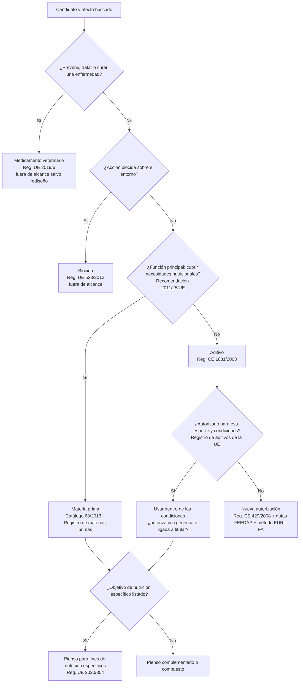

# Mapa regulatorio de la UE para productos de alimentación animal

Referencia de trabajo para el agente `regulacion-seguridad` y la skill `triage-regulatorio`. **No es asesoramiento
jurídico.** La normativa cambia: consulta siempre el texto consolidado en EUR-Lex y anota la fecha. Estado de
verificación a 2026-11-04: "verificada" = comprobada en esta revisión; "pendiente" = cita de referencia, comprobar
el texto consolidado antes de usarla en una decisión.

## Clasificación: la primera decisión

Los piensos no pueden alegar que previenen, tratan o curan enfermedades (Reglamento (CE) 767/2009, art. 13, con
excepciones limitadas). Un extracto autorizado como aromatizante (aditivo sensorial) no puede comercializarse
alegando efectos zootécnicos.

## Categorías y grupos funcionales de aditivos (anexo I del Reglamento (CE) 1831/2003)

| Categoría | Grupos funcionales (resumen; verificar texto consolidado) |
|---|---|
| Tecnológicos | Conservantes, antioxidantes, emulgentes, estabilizantes, espesantes, gelificantes, aglutinantes, control de radionúclidos, antiaglomerantes, reguladores de acidez, aditivos de ensilado, desnaturalizantes, reducción de micotoxinas, potenciadores de las condiciones higiénicas, otros tecnológicos (añadido por el Reglamento (UE) 2019/962) |
| Sensoriales | Colorantes, aromatizantes |
| Nutricionales | Vitaminas y sustancias de efecto similar, compuestos de oligoelementos, aminoácidos y análogos, urea y derivados |
| Zootécnicos | Digestibilidad, estabilizadores de la flora intestinal, sustancias que influyen favorablemente en el medio ambiente, otros zootécnicos, **estabilizadores de las condiciones fisiológicas** (Reglamento (UE) 2019/962) |
| Coccidiostáticos e histomonóstatos | — |

## Normativa de referencia

| Norma | Ámbito | Cuándo aplica | Verificación |
|---|---|---|---|
| [Reglamento (CE) 178/2002](https://eur-lex.europa.eu/eli/reg/2002/178/oj) | Legislación alimentaria general (incluye piensos), EFSA | Siempre | pendiente |
| [Reglamento (CE) 1831/2003](https://eur-lex.europa.eu/eli/reg/2003/1831/oj) | Aditivos: autorización, categorías, etiquetado, protección de datos | Aditivos | pendiente |
| [Reglamento (CE) 429/2008](https://eur-lex.europa.eu/eli/reg/2008/429/oj) | Preparación y presentación de solicitudes de aditivos | Nuevas autorizaciones | pendiente |
| [Reglamento (UE) 2019/962](https://eur-lex.europa.eu/eli/reg/2019/962/oj) | Nuevos grupos: estabilizadores de las condiciones fisiológicas y otros tecnológicos | Productos de resiliencia, estrés oxidativo o calórico | verificada |
| [Reglamento (CE) 767/2009](https://eur-lex.europa.eu/eli/reg/2009/767/oj) | Comercialización, etiquetado y alegaciones de piensos | Siempre | pendiente |
| [Reglamento (UE) 68/2013](https://eur-lex.europa.eu/eli/reg/2013/68/oj) y modificaciones | Catálogo de materias primas | Materias primas | pendiente |
| [Reglamento (UE) 2020/354](https://eur-lex.europa.eu/eli/reg/2020/354/oj) | Usos previstos de piensos para fines de nutrición específicos | Objetivos como reducir el riesgo de cetosis o de fiebre de la leche | verificada (entrada de fiebre de la leche modificada por el Reglamento (UE) 2024/2899) |
| [Recomendación 2011/25/UE](https://eur-lex.europa.eu/eli/reco/2011/25/oj) | Distinción entre materia prima, aditivo, biocida y medicamento | Clasificación | verificada |
| [Reglamento (CE) 183/2005](https://eur-lex.europa.eu/eli/reg/2005/183/oj) | Higiene de los piensos, registro y autorización de operadores | Fabricación | pendiente |
| [Directiva 2002/32/CE](https://eur-lex.europa.eu/eli/dir/2002/32/oj) | Sustancias indeseables (metales, micotoxinas, dioxinas...) | Siempre | pendiente |
| [Reglamento (UE) 2019/6](https://eur-lex.europa.eu/eli/reg/2019/6/oj) | Medicamentos veterinarios | Frontera con alegaciones terapéuticas | pendiente |
| [Reglamento (UE) 2019/4](https://eur-lex.europa.eu/eli/reg/2019/4/oj) | Piensos medicamentosos | Frontera | pendiente |
| [Reglamento (UE) 528/2012](https://eur-lex.europa.eu/eli/reg/2012/528/oj) | Biocidas | Frontera | pendiente |
| [Reglamento (CE) 1829/2003](https://eur-lex.europa.eu/eli/reg/2003/1829/oj) y [1830/2003](https://eur-lex.europa.eu/eli/reg/2003/1830/oj) | OMG en alimentos y piensos; trazabilidad y etiquetado | Productos de fermentación con cepas modificadas | pendiente |
| [Reglamento (CE) 396/2005](https://eur-lex.europa.eu/eli/reg/2005/396/oj) | Límites máximos de residuos de plaguicidas | Extractos y materias primas vegetales | pendiente |
| [Reglamento (CE) 1069/2009](https://eur-lex.europa.eu/eli/reg/2009/1069/oj) y [Reglamento (UE) 142/2011](https://eur-lex.europa.eu/eli/reg/2011/142/oj) | Subproductos animales | Ingredientes de origen animal | pendiente |
| [Reglamento (CE) 999/2001](https://eur-lex.europa.eu/eli/reg/2001/999/oj) | EET (restricciones de proteínas animales transformadas) | Proteínas de origen animal | pendiente |
| [Reglamento (UE) 2017/625](https://eur-lex.europa.eu/eli/reg/2017/625/oj) | Controles oficiales | Comercialización | pendiente |
| [Reglamento (UE) 2015/2283](https://eur-lex.europa.eu/eli/reg/2015/2283/oj) | Nuevos alimentos (consumo humano) | Solo si el ingrediente también es alimento humano | pendiente |
| [Directiva 2010/63/UE](https://eur-lex.europa.eu/eli/dir/2010/63/oj) y [Real Decreto 53/2013](https://www.boe.es/eli/es/rd/2013/02/01/53) | Protección de los animales utilizados con fines científicos | Cualquier procedimiento con animales (incluidos donantes de líquido ruminal) | pendiente |
| [Directiva 2004/10/CE](https://eur-lex.europa.eu/eli/dir/2004/10/oj) | Buenas prácticas de laboratorio | Estudios de seguridad para dossier | pendiente |

## Guías de EFSA (Panel FEEDAP)

Consulta la versión vigente de cada guía en EFSA Journal (`nutria buscar efsa "FEEDAP guidance"`): identidad y
caracterización; seguridad para la especie diana; seguridad para el consumidor; seguridad para el usuario; seguridad
para el medio ambiente; eficacia [verificada: EFSA J 16(5):5274, 2018, DOI 10.2903/j.efsa.2018.5274]; caracterización
de microorganismos; renovación de autorizaciones.

## Implicaciones comerciales que conviene evaluar pronto

- **Método analítico**: sin método para cuantificar el activo (o un marcador) no hay autorización ni control de calidad.
- **Autorizaciones ligadas al titular** en aditivos zootécnicos y protección de los datos del dossier: barrera de
  entrada a competidores (verificar las condiciones vigentes del Reglamento (CE) 1831/2003).
- **Plazo y coste** de una autorización nueva: dossier, ensayos de eficacia (varios estudios en la especie diana) y
  evaluación de EFSA. Estímalos con fuentes o como `[SUP]` en `nutria econ desarrollador`.
- **Mercados fuera de la UE**: cada uno tiene su vía (p. ej. FDA-CVM en EE. UU., MAPA en Brasil); evalúalos si forman
  parte del plan comercial.
- **España**: competencias del MAPA en alimentación animal; verificar la normativa nacional aplicable.
